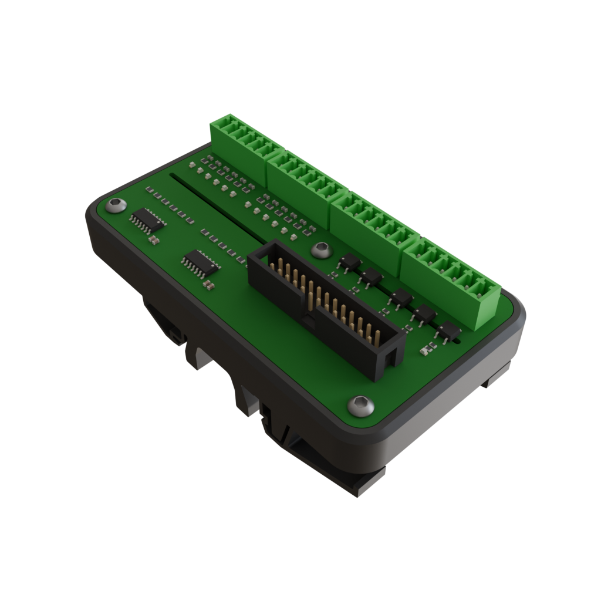
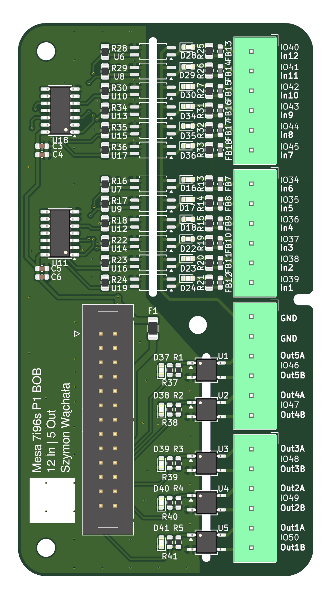
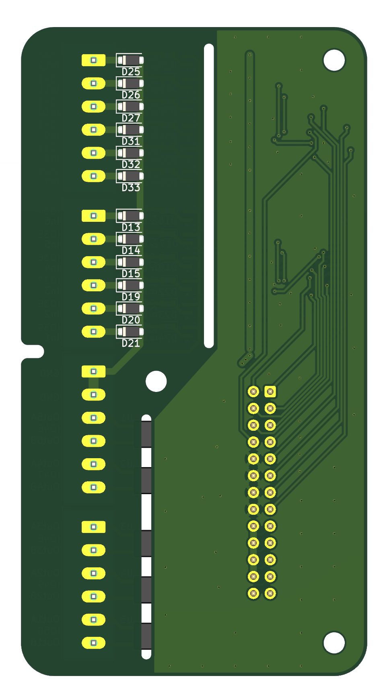

# Mesa 7i96S P1 I/O Breakout Board


This is a breakout board for the **P1 (DB25) expansion port of the [Mesa 7i96S](https://mesanet.com/)**. It turns the 17 raw 3.3 V GPIO pins of P1 into
**12 galvanically isolated 24 V inputs** and **5 solid-state relay outputs**. The outputs are on pluggable screw terminals, and the board sits on a 3D-printed DIN-rail mount.

<p align="center">
  
</p>

| Front | Back |
| :---: | :--: |
|  |  |

---

## Features

- **12 inputs, 24 V, optically isolated.** Each input has a TLP293 optocoupler, a 74HC14 Schmitt-trigger buffer, a bidirectional TVS (SMF30CA), a ferrite-bead filter and a status LED.
- **5 outputs, solid-state relays.** The CPC1017N SSRs give isolated, polarity-free contacts that switch AC or DC. Each output has a status LED.
- **Pluggable 3.5 mm terminal blocks** (Phoenix MCV-style) on the field side.
- **26-pin IDC header** that connects to the 7i96S P1 with a standard IDC26 ⇄ DB25 ribbon cable.
- **Powered from the Mesa card.** The logic side takes +5 V from P1, behind a 100 mA fuse. The board needs no extra logic supply.
- **3D-printed DIN-rail mount.** STL, 3MF and Blender source are included.

## Specifications

| Parameter | Value |
| --- | --- |
| Inputs | 12, isolated, sourcing (PNP / +24 V = active) |
| Input voltage | 24 V nominal, clamped by 30 V TVS |
| Input current | ≈ 4–5 mA @ 24 V |
| Input isolation | Optocoupler; the input common (`GND` terminals) is separate from Mesa GND |
| Outputs | 5, SSR contacts (CPC1017N), AC/DC |
| Output voltage | max **30 V** |
| Output current | max **100 mA** per channel |
| Logic supply | +5 V from Mesa P1, fused 100 mA |
| PCB size | 52.5 × 98 mm, 2 layers |

## Pinout

### Field terminals (top → bottom, as printed on the silkscreen)

| Terminal | Signal | Mesa pin | LinuxCNC HAL pin |
| --- | --- | --- | --- |
| J5.1 | In12 | IO40 | `hm2_7i96s.0.gpio.040.in` |
| J5.2 | In11 | IO41 | `hm2_7i96s.0.gpio.041.in` |
| J5.3 | In10 | IO42 | `hm2_7i96s.0.gpio.042.in` |
| J5.4 | In9  | IO43 | `hm2_7i96s.0.gpio.043.in` |
| J5.5 | In8  | IO44 | `hm2_7i96s.0.gpio.044.in` |
| J5.6 | In7  | IO45 | `hm2_7i96s.0.gpio.045.in` |
| J3.1 | In6  | IO34 | `hm2_7i96s.0.gpio.034.in` |
| J3.2 | In5  | IO35 | `hm2_7i96s.0.gpio.035.in` |
| J3.3 | In4  | IO36 | `hm2_7i96s.0.gpio.036.in` |
| J3.4 | In3  | IO37 | `hm2_7i96s.0.gpio.037.in` |
| J3.5 | In2  | IO38 | `hm2_7i96s.0.gpio.038.in` |
| J3.6 | In1  | IO39 | `hm2_7i96s.0.gpio.039.in` |
| J4.1, J4.2 | GND (input common, isolated) | – | – |
| J4.3 / J4.4 | Out5 A / B | IO46 | `hm2_7i96s.0.gpio.046.out` |
| J4.5 / J4.6 | Out4 A / B | IO47 | `hm2_7i96s.0.gpio.047.out` |
| J6.1 / J6.2 | Out3 A / B | IO48 | `hm2_7i96s.0.gpio.048.out` |
| J6.3 / J6.4 | Out2 A / B | IO49 | `hm2_7i96s.0.gpio.049.out` |
| J6.5 / J6.6 | Out1 A / B | IO50 | `hm2_7i96s.0.gpio.050.out` |

### Mesa connector (J7, IDC 2×13)

| J7 pin | DB25 pin* | Signal |
| --- | --- | --- |
| 1, 2, 3, 4, 5, 6, 7, 8, 9 | 1, 14, 2, 15, 3, 16, 4, 17, 5 | IO34 … IO42 |
| 11, 13, 15 | 6, 7, 8 | IO43, IO44, IO45 |
| 17, 19, 21, 23, 25 | 9, 10, 11, 12, 13 | IO46 … IO50 |
| 10, 12, 14, 16 | 18, 19, 20, 21 | GND |
| 18, 20, 22, 24 | 22, 23, 24, 25 | +5 V (from Mesa) |
| 26 | – | not connected |

\* With a standard flat IDC26 ⇄ DB25 cable.

> [!IMPORTANT]
> The board takes its logic power from the +5 V on the P1 connector. Check in the 7i96S manual that +5 V is enabled on P1.

## Wiring

**Inputs.** Each input is active when +24 V is applied to the `InX` terminal relative to the `GND` terminals (J4.1/J4.2). Connect the 0 V of your 24 V field supply to `GND`. This suits PNP (sourcing) sensors, switches to +24 V, and similar. The input common is **not** connected to Mesa ground, so isolation is preserved.

```
+24V ──[switch / PNP sensor]──► InX
0V   ─────────────────────────► GND (J4.1 / J4.2)
```

**Outputs.** Each output is a floating SSR contact between `OutXA` and `OutXB`. Wire it like a relay contact in series with the load. It works for DC or AC up to 30 V and 100 mA, which is enough for a relay coil, a pilot light or a PLC input. Use an external relay or contactor for bigger loads, and use a flyback diode on inductive DC loads.

```
+V ──[load]──► OutXA   OutXB ──► 0V
```

## LinuxCNC configuration

The P1 pins must be configured as plain GPIO in the 7i96S firmware. Input polarity is not inverted: an active input reads `TRUE`. An output set to `TRUE` closes the SSR.

```hal
# Outputs: P1 GPIO are inputs by default
setp hm2_7i96s.0.gpio.046.is_output true
setp hm2_7i96s.0.gpio.047.is_output true
setp hm2_7i96s.0.gpio.048.is_output true
setp hm2_7i96s.0.gpio.049.is_output true
setp hm2_7i96s.0.gpio.050.is_output true

# Examples
net spindle-cw     spindle.0.forward          => hm2_7i96s.0.gpio.050.out   # Out1
net coolant-flood  iocontrol.0.coolant-flood  => hm2_7i96s.0.gpio.049.out   # Out2

net probe-in       hm2_7i96s.0.gpio.039.in    => motion.probe-input         # In1
net tool-setter    hm2_7i96s.0.gpio.038.in    => motion.digital-in-00       # In2
```

## License

This project is licensed under [**Creative Commons Attribution 4.0 International (CC BY 4.0)**](LICENSE).

You may use, modify, manufacture and sell the design, including commercially, provided that you **credit the author**. For example:

> Based on *Mesa 7i96S P1 I/O Breakout Board* by Szymon Wąchała – https://github.com/Szymon423/24-DB25-BOB-IO

Author: **Szymon Wąchała**
